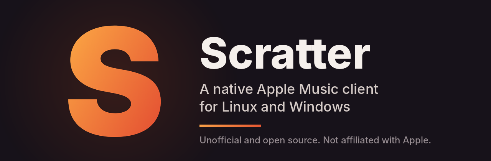
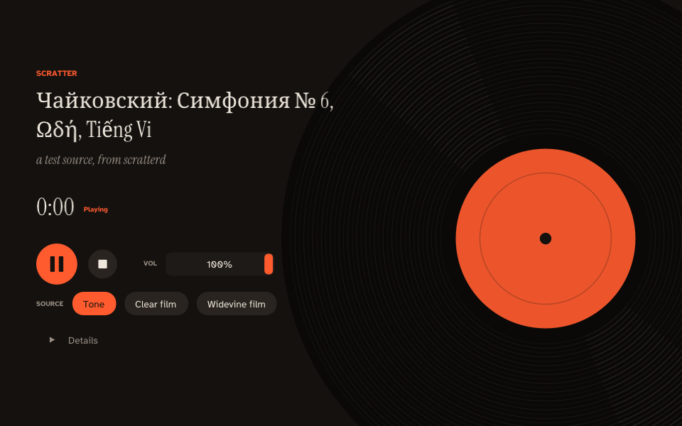
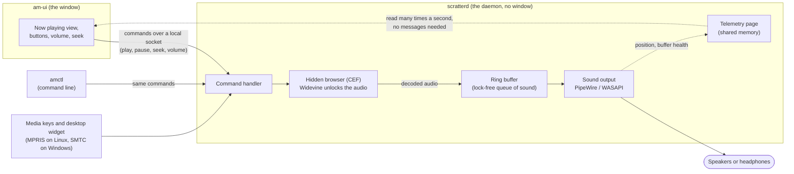

<p align="center">
  
</p>

<p align="center">
  <a href="https://github.com/scratterapp/scratter/actions/workflows/ci.yml"></a>
  <a href="LICENSE"></a>
  
  
</p>

> [!IMPORTANT]
> Scratter is an unofficial, independent project. It is **not affiliated with or
> endorsed by Apple Inc.** Apple Music is a trademark of Apple Inc. You need your own
> Apple Music subscription.

Scratter is a small, native Apple Music player for Linux and Windows. The music keeps
playing when you close the window, the window opens again in a blink, and it doesn't
carry a whole web browser around just to show you a playlist.

> [!WARNING]
> **Early development, not usable for Apple Music yet.** The player, the window, media
> keys and the DRM path all work today with a test tone and Google's public test films,
> but signing in to Apple Music and playing your library hasn't been built. Nothing is
> packaged or released. See [Where it stands](#where-it-stands).

<p align="center">
  
  <br>
  <sub>The app window today, playing the built-in test tone. The title shows the fonts
  handling Cyrillic, Greek and Vietnamese.</sub>
</p>

## The idea in one minute

Apple Music protects its songs with DRM (Google's Widevine on Linux and Windows), and
the only practical way to play them outside Apple's own apps is through a real browser
engine. Most third-party players solve that by building the whole app inside a browser
(Electron), which costs hundreds of megabytes of memory and makes the app feel like a
web page.

Scratter uses the browser for **only** the part that needs it. It is two programs that
work together, the same way `mpd` (a music daemon) and `ncmpcpp` (a window for it) do:

- **`scratterd`, the daemon.** A background program with no window. Inside it runs a
  hidden, stripped-down browser (CEF, the Chromium Embedded Framework) whose only job is
  to unlock the protected audio. The daemon takes the unlocked sound and plays it
  through the system's own audio (PipeWire on Linux, WASAPI on Windows). It also owns
  the media keys and the desktop's media controls, and stores your sign-in safely in the
  system keyring.
- **`am-ui`, the window.** A light native window (SDL3 + Dear ImGui) that only shows
  things and sends commands. Close it and the music keeps going. Open it again and it
  reattaches to the daemon in under 100 ms.

There's also **`amctl`**, a command-line remote for the daemon, which the tests and
scripts use so nothing ever needs a window.

## How it fits together



There are three paths between the two programs, each picked for its job:

1. **Commands** (play, pause, seek, volume, load a track) go from the window to the
   daemon as small binary messages over a Unix socket on Linux or a named pipe on
   Windows.
2. **Audio** never leaves the daemon. The hidden browser hands decoded sound to a
   lock-free ring buffer, and the sound card's thread pulls it out without ever
   waiting on a lock, so the music doesn't stutter when something else is busy.
3. **Live status** (where the song is, whether the buffer is healthy) is written by the
   daemon into a page of shared memory that the window simply reads, so a smooth
   progress bar costs nothing.

Everything that differs between Linux and Windows lives behind one set of interfaces
in `src/pal/` (the Platform Abstraction Layer). The rest of the code is the same on
both systems.

## Where it stands

| Part | Linux | Windows |
| --- | --- | --- |
| Daemon plays sound through the ring buffer | Yes (PipeWire) | Yes (WASAPI, shared and exclusive) |
| Hidden browser plays Google's Widevine test film | Yes | Yes |
| Commands over the local socket, `amctl` remote | Yes | Yes |
| Shared-memory telemetry | Yes | Yes |
| Media keys and desktop media widget | Yes (MPRIS) | Yes (SMTC) |
| Secure sign-in storage | Yes (Secret Service keyring) | Yes (DPAPI) |
| App window: now playing, play/pause, stop, volume, seek, source picker | Yes | Yes |
| Close and reopen the window 50 times without a skip in the sound | Yes | Yes |
| Launcher entry and app icon | Yes | Icon only |
| Signing in to Apple Music, library, search, playlists | Not started | Not started |
| Packaged releases | None | None |

The biggest open item is the Apple Music connection itself (issue
[#4](https://github.com/scratterapp/scratter/issues/4)). It needs an Apple developer
token, and we don't have one yet. The live list of what's done and what's next is the
pinned **[roadmap issue #6](https://github.com/scratterapp/scratter/issues/6)**.

This is roughly where the window is heading once the library exists. It's a design
mockup, not working code, and every name in it is made up:

<p align="center">
  
</p>

## Try it

You'll need CMake 3.25+, Ninja and Clang on Linux, or MSVC on Windows.
[docs/SETUP.md](docs/SETUP.md) lists the exact packages for Arch, Ubuntu and Windows.

```sh
cmake --preset linux-debug
cmake --build --preset linux-debug
ctest --preset linux-debug
```

Then start the daemon in one terminal (it plays a 440 Hz test tone, so turn your volume down), and open the
window or use the remote from a second one:

```sh
./build/linux-debug/scratterd
./build/linux-debug/src/client/am-ui
./build/linux-debug/amctl pause
./build/linux-debug/amctl volume 30
./build/linux-debug/amctl status
```

On Windows, use the `windows-msvc-debug` preset from a Developer PowerShell for
VS 2022. Playing the Widevine test film needs our own CEF build; that recipe is in
[docs/CEF.md](docs/CEF.md).

## A few words you'll see a lot

| Word | What it means here |
| --- | --- |
| Daemon | A program that runs in the background with no window. Ours is `scratterd`. |
| CEF | Chromium Embedded Framework: the Chrome engine as a library. We run it hidden, inside the daemon. |
| Widevine | Google's DRM system. Apple Music uses it on Linux and Windows. The browser engine talks to it; we never touch the keys. |
| PipeWire / WASAPI | The system sound services on Linux and Windows. |
| MPRIS / SMTC | How Linux and Windows let a desktop media widget and the media keys control a player. |
| IPC | Inter-process communication: the messages between the window and the daemon. |
| Ring buffer | A fixed-size circular queue. One thread writes sound in, another reads it out, and neither waits for the other. |
| PAL | Platform Abstraction Layer (`src/pal/`): the only place where Linux and Windows code differ. |

## The code, briefly

```
src/common/       shared building blocks: ring buffer, IPC messages, telemetry page
src/pal/          platform layer: interfaces/, linux/, win32/
src/daemon/       scratterd: audio engine, hidden browser host (cef_host/), commands
src/client/       am-ui: the window and its link to the daemon
src/net/          Apple Music web API client (not started)
tools/            amctl, the 50-relaunch test, soak and performance tools
tests/            Catch2 tests, one executable per file, plus fuzzers
docs/             the full documentation (list below)
packaging/        Linux launcher entry and icons, Windows icon
```

## Working on it

Two people build Scratter in parallel: robbie ([@cocoa55](https://github.com/cocoa55))
owns the Linux side and kero ([@kerelosgayed](https://github.com/kerelosgayed)) owns the
Windows side. Shared code is reviewed by both.

**New here, or an AI agent?** Read [CLAUDE.md](CLAUDE.md) first. Despite the name it's
for everyone: who owns what, the rules (no exceptions, warnings are errors, no
platform `#ifdef`s outside `src/pal/`, no allocation in the audio callback), how to
build and test, and where to start. Then
[docs/COLLABORATION.md](docs/COLLABORATION.md) covers how to pick up an issue and
work it.

### Documentation

- [docs/OVERVIEW.md](docs/OVERVIEW.md): what the system does, end to end, with a walkthrough of playing a song
- [docs/ARCHITECTURE.md](docs/ARCHITECTURE.md): process and data boundaries
- [docs/SPECIFICATION.md](docs/SPECIFICATION.md): the full technical spec and phase roadmap
- [docs/RATIONALE.md](docs/RATIONALE.md): why this exists, compared with Cider and the official app
- [docs/COLLABORATION.md](docs/COLLABORATION.md): how the two platform owners work in parallel
- [docs/CEF.md](docs/CEF.md): the hidden browser in the daemon, and how to build our CEF
- [docs/BENCHMARKS.md](docs/BENCHMARKS.md): measured performance and how to measure it
- [docs/SETUP.md](docs/SETUP.md): installing dependencies
- [docs/windows/START_HERE.md](docs/windows/START_HERE.md): the entry point for Windows work

## What Scratter will never do

- **It's a player, nothing more.** No recording, saving or exporting of decrypted audio,
  and no way around the DRM. The browser engine unlocks the audio inside the daemon and
  it goes straight to your speakers.
- **We never ship the Widevine module.** It comes from Google and stays wherever it's
  already installed on your machine (on Arch, the `chromium-widevine` AUR package).
- **No borrowed identity.** No pretending to be another app, and no reusing the token
  Apple's web player uses.
- **No binaries until the legal side is settled.** Our CEF is built with AAC support,
  and the patent licensing for that has to be sorted out before anything is released.
  [docs/release-checklist.md](docs/release-checklist.md) lists everything that has to be
  true first.

[LEGAL.md](LEGAL.md) has the full notice, and [SECURITY.md](SECURITY.md) explains how to
report a security problem. Scratter is released under the [MIT license](LICENSE).
