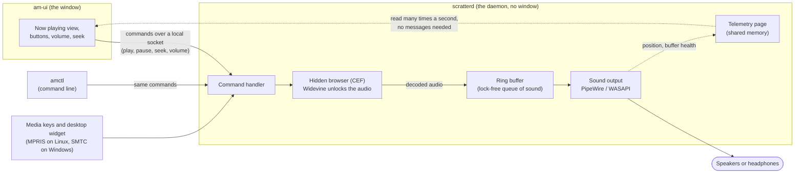
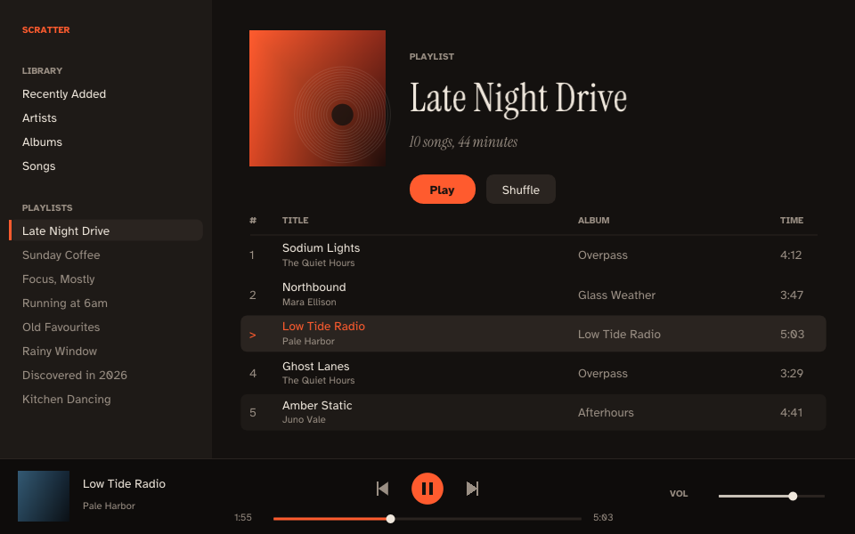

<p align="center">
  
</p>

<p align="center">
  <a href="https://github.com/scratterapp/scratter/actions/workflows/ci.yml"></a>
  <a href="LICENSE"></a>
  
  
</p>

<p align="center">
  <a href="#try-it">Try it</a> ·
  <a href="#how-it-fits-together">How it works</a> ·
  <a href="#under-the-hood">Under the hood</a> ·
  <a href="#where-it-stands">Status</a> ·
  <a href="#working-on-it">Contributing</a> ·
  <a href="https://github.com/scratterapp/scratter/issues/6">Roadmap</a>
</p>

> [!IMPORTANT]
> Scratter is an unofficial, independent project. It is **not affiliated with or
> endorsed by Apple Inc.** Apple Music is a trademark of Apple Inc. You need your own
> Apple Music subscription.

Scratter is a native Apple Music player for Linux and Windows. Playback runs in a
background process, so closing the window doesn't stop the music, and the window
itself is plain C++ rather than a web page.

> [!WARNING]
> **Early development, not usable for Apple Music yet.** The player, the window, media
> keys and the DRM path all work today with a test tone and Google's public test films,
> but signing in to Apple Music and playing your library hasn't been built. Nothing is
> packaged or released. See [Where it stands](#where-it-stands).

<p align="center">
  
  <br>
  <sub>The app window today, playing the built-in test tone. The title shows the fonts
  handling Cyrillic, Greek and Vietnamese.</sub>
</p>

## Why two programs

Apple Music protects its songs with DRM (Google's Widevine on Linux and Windows), and
the only practical way to play them outside Apple's own apps is through a real browser
engine. Most third-party players solve that by building the whole app inside a browser
(Electron), which costs hundreds of megabytes of memory and makes the app feel like a
web page.

Scratter uses the browser for **only** the part that needs it. It is two programs that
work together, the same way `mpd` (a music daemon) and `ncmpcpp` (a window for it) do:

- **`scratterd`, the daemon.** A background program with no window. Inside it runs a
  hidden, stripped-down browser (CEF, the Chromium Embedded Framework) whose only job is
  to unlock the protected audio. The daemon takes the unlocked sound and plays it
  through the system's own audio (PipeWire on Linux, WASAPI on Windows). It also owns
  the media keys and the desktop's media controls, and stores your sign-in safely in the
  system keyring.
- **`am-ui`, the window.** A light native window (SDL3 + Dear ImGui) that only shows
  things and sends commands. Close it and the music keeps going. Open it again and it
  reattaches to the daemon in under 100 ms.

There's also **`amctl`**, a command-line remote for the daemon, which the tests and
scripts use so nothing ever needs a window.

## How it fits together



The two programs talk in three ways:

1. **Commands** (play, pause, seek, volume, load a track) go from the window to the
   daemon as small binary messages over a Unix socket on Linux or a named pipe on
   Windows.
2. **Audio** never leaves the daemon. The hidden browser hands decoded sound to a
   lock-free ring buffer, and the sound card's thread pulls it out without ever
   waiting on a lock, so the music doesn't stutter when something else is busy.
3. **Live status** (where the song is, whether the buffer is healthy) is written by the
   daemon into a page of shared memory that the window reads directly, without
   sending the daemon any messages.

Everything that differs between Linux and Windows lives behind one set of interfaces
in `src/pal/` (the Platform Abstraction Layer). The rest of the code is the same on
both systems.

## Under the hood

The full design is in [docs/SPECIFICATION.md](docs/SPECIFICATION.md) section 3.

### Hidden browser (`src/daemon/cef_host/`)

CEF plays the protected stream for us. It runs windowless, with the GPU off,
extensions off and a single renderer process. The Widevine CDM is loaded from
wherever the system already has it; we never ship it. Chromium's own audio output
is replaced by `CefAudioHandler::OnAudioStreamPacket`, which hands us decoded float
PCM in memory. Stock CEF does this for protected audio without patches; we only
rebuild CEF so it can decode AAC ([docs/CEF.md](docs/CEF.md)).

### Ring buffer (`src/common/spsc_ring_buffer.hpp`)

A lock-free single-producer, single-consumer queue between the browser and the
sound card: the CEF thread writes, the audio thread reads, and they only share two
atomic counters. It aims to hold about 85 ms of audio (4096 frames at 48 kHz). The
Phase 1 gate pushed 100 million frames through it across two CPU cores under
ThreadSanitizer.

### Drift controller and resampler (`src/daemon/audio_engine/`)

The browser produces audio on the system clock and the sound card consumes it on
its own crystal, typically 10 to 200 parts per million apart. Left alone, the ring
buffer would slowly fill up or run dry. On every callback an exponential moving
average smooths the buffer's fill level and a PI controller turns the error into a
playback ratio, clamped to ±1000 ppm, which is too small to hear. A 16-tap
windowed-sinc polyphase resampler plays at that ratio. The test injects a +150 ppm
skew for a simulated hour and checks the fill stays within ±3% of target.

### Sound output (`src/pal/linux/`, `src/pal/win32/`)

PipeWire on Linux, WASAPI on Windows (shared mode, or exclusive with
`--exclusive`). After the stream starts, our callback never allocates memory, takes
a lock or makes a system call, so nothing it does can make the sound skip. On pause
it fades out and then stops the stream, so the audio thread sleeps instead of
playing silence.

### Control channel (`src/common/ipc_protocol.hpp`, `ipc_messages.hpp`)

This is how the window and `amctl` send commands. Every message is a fixed 32-byte
header (magic number, length, sequence id, timestamp, version, opcode, flags and a
CRC32C checksum of the header) and up to 64 KiB of payload. It goes over a
`SOCK_SEQPACKET` Unix socket on Linux and a message-mode named pipe on Windows, so
each message arrives whole. Payloads are padding-free structs checked at compile
time. CI fuzzes the frame parser with 10 million mutated inputs under
AddressSanitizer. The median round trip is 7.5 µs.

### Telemetry page (`src/common/telemetry_shm.hpp`)

One page of shared memory that the daemon writes up to 120 times a second and the
window maps read-only, which is how the window shows the song position without
asking. A sequence lock (SeqLock) lets the reader detect and retry a half-written
copy while the writer never waits. The payload is stored as atomic 64-bit words, so
even a torn read is well-defined.

### Reactor (`src/pal/linux/`, `src/pal/win32/`)

`epoll` on Linux, I/O completion ports on Windows. The daemon's socket, its shutdown
signal and D-Bus (for MPRIS) all run on this one thread, so the control side of the
daemon needs no locks.

### Media controls and sign-in storage

MPRIS over sd-bus on Linux and SMTC on Windows let the media keys and the desktop's
media widget control the daemon even with the window closed. Credentials go in the
Secret Service keyring (libsecret) on Linux and DPAPI on Windows.

## Performance

Measured on robbie's PC (CachyOS, 6 cores) with the optimized build playing the
Widevine test film. How to measure, and every change that moved a number, are in
[docs/BENCHMARKS.md](docs/BENCHMARKS.md).

| Measure | First measured (2026-10-19) | Now | Goal |
| --- | --- | --- | --- |
| Memory really used, all processes, playing | 693 MB | 422 MB | under 500 MB |
| CPU while playing, all processes | 9.8% of one core | 2.7% | under 5% |
| CPU while paused | not measured | 0.6% | under 0.5% |
| Video memory used by the daemon | 0 MB | 0 MB | stays 0 MB |
| Window command round trip (median) | 7.5 µs | 7.5 µs | under 25 µs |
| Open the window to showing the daemon's state (median of 50) | | 99 ms | under 100 ms |
| Sound glitches while the window opened and closed 50 times | | 0 | 0 |

Almost all of the memory is Chromium, which Widevine needs. The daemon playing
the plain test tone, without CEF, uses about 4 MB. On Windows the window
currently takes about 216 ms to show the daemon's state (kero's PC), which
hasn't been looked into yet.

## Where it stands

| Part | Linux | Windows |
| --- | --- | --- |
| Daemon plays sound through the ring buffer | Yes (PipeWire) | Yes (WASAPI, shared and exclusive) |
| Hidden browser plays Google's Widevine test film | Yes | Yes |
| Commands over the local socket, `amctl` remote | Yes | Yes |
| Shared-memory telemetry | Yes | Yes |
| Media keys and desktop media widget | Yes (MPRIS) | Yes (SMTC) |
| Secure sign-in storage | Yes (Secret Service keyring) | Yes (DPAPI) |
| App window: now playing, play/pause, stop, volume, seek, source picker | Yes | Yes |
| Close and reopen the window 50 times without a skip in the sound | Yes | Yes |
| Launcher entry and app icon | Yes | Icon only |
| Signing in to Apple Music, library, search, playlists | Not started | Not started |
| Packaged releases | None | None |

Progress through the roadmap phases in [the spec's section 6](docs/SPECIFICATION.md).
Each phase ends in a test gate:

| Phase | What it is | State |
| --- | --- | --- |
| 1 | Lock-free ring buffer, shared memory, the control channel | Done on both |
| 2 | Real-time audio output and the clock-drift loop | Done on both |
| 3 | Hidden browser, Widevine, sign-in storage | Browser, Widevine and storage done; Apple Music sign-in not started |
| 4 | Network and catalog engine, media controls | Media controls done; `src/net/` (libcurl + simdjson) not started |
| 5 | The detachable window | Window and the 50-relaunch gate done; library views and the visualizer not started |

The biggest open item is the Apple Music connection itself (issue
[#4](https://github.com/scratterapp/scratter/issues/4)). It needs an Apple developer
token, and we don't have one yet. The live list of what's done and what's next is the
pinned **[roadmap issue #6](https://github.com/scratterapp/scratter/issues/6)**.

The playlist view below is a design mockup for when the library exists. It isn't
working code, and the names in it are made up.

<p align="center">
  
</p>

## Try it

You'll need CMake 3.25+, Ninja and Clang on Linux, or MSVC on Windows.
[docs/SETUP.md](docs/SETUP.md) lists the exact packages for Arch, Ubuntu and Windows.

```sh
cmake --preset linux-debug
cmake --build --preset linux-debug
ctest --preset linux-debug
```

Start the daemon in one terminal. It plays a 440 Hz test tone, so turn your volume
down first. Then open the window or use the remote from a second terminal:

```sh
./build/linux-debug/scratterd
./build/linux-debug/src/client/am-ui
./build/linux-debug/amctl pause
./build/linux-debug/amctl volume 30
./build/linux-debug/amctl status
```

On Windows, use the `windows-msvc-debug` preset from a Developer PowerShell for
VS 2022. Playing the Widevine test film needs our own CEF build; that recipe is in
[docs/CEF.md](docs/CEF.md).

## Glossary

| Word | What it means here |
| --- | --- |
| Daemon | A program that runs in the background with no window. Ours is `scratterd`. |
| CEF | Chromium Embedded Framework: the Chrome engine as a library. We run it hidden, inside the daemon. |
| Widevine | Google's DRM system. Apple Music uses it on Linux and Windows. The browser engine talks to it; we never touch the keys. |
| PipeWire / WASAPI | The system sound services on Linux and Windows. |
| MPRIS / SMTC | How Linux and Windows let a desktop media widget and the media keys control a player. |
| IPC | Inter-process communication: the messages between the window and the daemon. |
| Ring buffer | A fixed-size circular queue. One thread writes sound in, another reads it out, and neither waits for the other. |
| PAL | Platform Abstraction Layer (`src/pal/`): the only place where Linux and Windows code differ. |

## Repository layout

```
src/common/       shared building blocks: ring buffer, IPC messages, telemetry page
src/pal/          platform layer: interfaces/, linux/, win32/
src/daemon/       scratterd: audio engine, hidden browser host (cef_host/), commands
src/client/       am-ui: the window and its link to the daemon
src/net/          Apple Music web API client (not started)
tools/            amctl, the 50-relaunch test, soak and performance tools
tests/            Catch2 tests, one executable per file, plus fuzzers
docs/             the full documentation (list below)
packaging/        Linux launcher entry and icons, Windows icon
```

## Working on it

Two people build Scratter in parallel: robbie ([@cocoa55](https://github.com/cocoa55))
owns the Linux side and kero ([@kerelosgayed](https://github.com/kerelosgayed)) owns the
Windows side. Shared code is reviewed by both.

**New here, or an AI agent?** Read [CLAUDE.md](CLAUDE.md) first. It's for everyone,
not just Claude, and covers who owns what, the rules (no exceptions, warnings are errors, no
platform `#ifdef`s outside `src/pal/`, no allocation in the audio callback), how to
build and test, and where to start. Then
[docs/COLLABORATION.md](docs/COLLABORATION.md) covers how to pick up an issue and
work it.

### Where to go next

| I want to... | Read |
| --- | --- |
| Understand what the system does, start to finish | [docs/OVERVIEW.md](docs/OVERVIEW.md) |
| See the process and data boundaries | [docs/ARCHITECTURE.md](docs/ARCHITECTURE.md) |
| Read the full technical design and the phase gates | [docs/SPECIFICATION.md](docs/SPECIFICATION.md) |
| Know why this exists next to Cider and the official app | [docs/RATIONALE.md](docs/RATIONALE.md) |
| Install the build tools | [docs/SETUP.md](docs/SETUP.md) |
| Pick up an issue and work it | [docs/COLLABORATION.md](docs/COLLABORATION.md), then the [roadmap](https://github.com/scratterapp/scratter/issues/6) |
| Build our CEF or work on the hidden browser | [docs/CEF.md](docs/CEF.md) |
| Measure or improve performance | [docs/BENCHMARKS.md](docs/BENCHMARKS.md) |
| Work on the Windows side | [docs/windows/START_HERE.md](docs/windows/START_HERE.md) |
| Report a security problem | [SECURITY.md](SECURITY.md) |

## What Scratter will never do

- **Playback only.** No recording, saving or exporting of decrypted audio,
  and no way around the DRM. The browser engine unlocks the audio inside the daemon and
  it goes straight to your speakers.
- **We never ship the Widevine module.** It comes from Google and stays wherever it's
  already installed on your machine (on Arch, the `chromium-widevine` AUR package).
- **No borrowed identity.** No pretending to be another app, and no reusing the token
  Apple's web player uses.
- **No binaries until the legal side is settled.** Our CEF is built with AAC support,
  and the patent licensing for that has to be sorted out before anything is released.
  [docs/release-checklist.md](docs/release-checklist.md) lists everything that has to be
  true first.

[LEGAL.md](LEGAL.md) has the full notice, and [SECURITY.md](SECURITY.md) explains how to
report a security problem. Scratter is released under the [MIT license](LICENSE).
